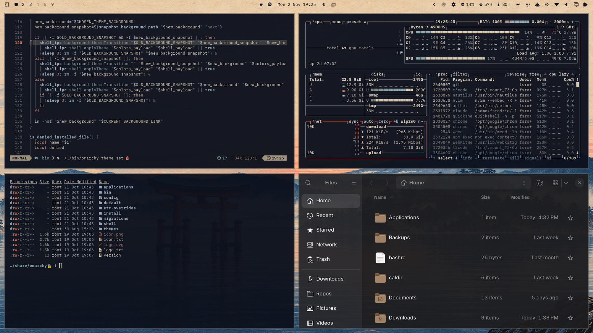
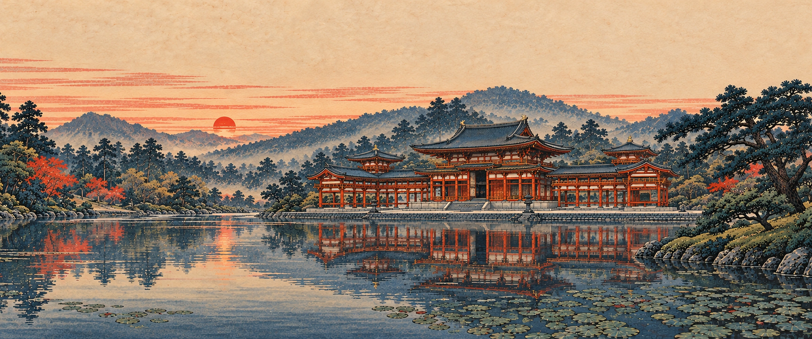
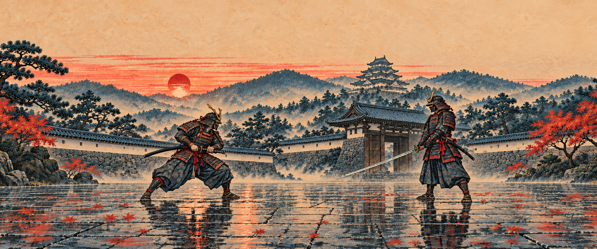
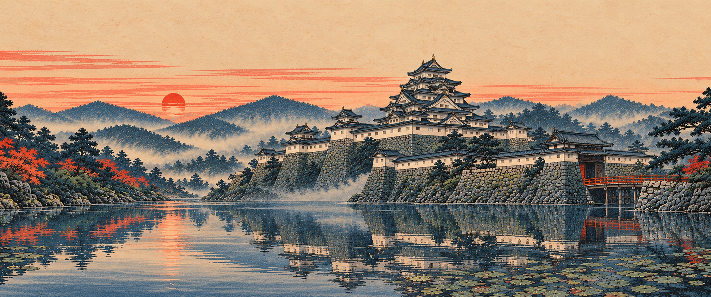

# Japan Autumn for Omarchy

An autumn evening in old Japan: woodblock-print wallpapers, deep ink-navy surfaces, warm parchment text, misty blue accents, and maple-red warnings.



## Install

```sh
omarchy theme install https://github.com/fsrodrig/omarchy-japan-autumn-theme
```

## Backgrounds

Four wallpapers are included. Cycle through them with `omarchy theme bg next`.

### Torii and Fuji


### Lakeside Temple



### Samurai Duel



### Castle at Dusk



Wallpapers were generated with AI image generation in a Japanese woodblock-print style and upscaled to 3440 × 1440 (21:9). On 16:9 screens they are cropped at the sides.

## Palette

| Role | Color |
| --- | --- |
| Background | `#0c111d` |
| Foreground | `#d6c9b1` |
| Misty blue accent | `#94a7ba` |
| Maple red | `#eb5e3f` |
| Selection | `#d6c9b1` |

The palette was made with [Aether](https://github.com/bjarneo/aether). Omarchy generates application themes from `colors.toml`.

## License

MIT
